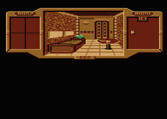

# A.D. 2044: Sexmisja

A reconstruction of the game's Forth executable, with editable rooms, maps,
pictures and text. The executable retains the original addresses and bytes.
The disks are packed afresh: old editor records, historical saves, abandoned
resources and disk padding are not source files.



Start with [room 01](rooms/01), a small corridor. Its
[scene](rooms/01/scene.txt) places the [picture](rooms/01/base.png) and
[hitmap](rooms/01/base.hit.txt). A `2` in the hitmap selects
zone `[02]` in [actions.txt](rooms/01/actions.txt): use the right exit, or examine “KORYTARZ.”
The [world map](world/map.txt) supplies that room's position, facing and open
exits. Initially, room 01's right exit leads to room 02.

| Where | What to edit |
| --- | --- |
| [world/map.txt](world/map.txt) | Room coordinates, facing, map glyphs and open directions |
| [world/initial.txt](world/initial.txt) | Starting room, energy, inventory and puzzle cells |
| [rooms/00…36](rooms) | One folder per room; pictures, hitmaps, actions and initial views |
| `rooms/NN/room.txt` | Which drawable objects initially appear in each view |
| `rooms/NN/scene.txt` | Picture positions, Atari colors and resource IDs |
| `rooms/NN/*.png` | Editable four-color indexed pictures and animation frames |
| `rooms/NN/*.hit.txt` | Character grids identifying clickable zones |
| `rooms/NN/actions.txt` | All room actions and messages, grouped by clickable zone |
| [items](items) | Inventory pictures and actions, grouped into the engine's four-item banks |
| [interface](interface) | Title, screen frame, fonts, cursor and [credits.txt](interface/credits.txt) |
| [ending](ending) | Ending background and frames, with the message in [scene.txt](ending/scene.txt) |
| [music/ad2044.snd](music/ad2044.snd) | Original custom music/effects bank; binary for now |
| [src/30-game.fth](src/30-game.fth) | Game logic; framework and kernel are beside it |
| [tools](tools) | Builders, validation and optional recovery tools |
| `build/` | Generated disks, compiler, packing report and research catalogs; ignored by Git |

[Room format notes](rooms/README.md), [inventory notes](items/README.md) and
[world notes](world/README.md) explain the numeric IDs and engine limits.
The numbers are runtime identities, not disk addresses. Lengths, compression,
sector positions and the directory are calculated by the builder.

## Build

Python 3.9 or later, GNU Make 3.81 or later and the pinned `py65` dependency
are required for host compilation. macOS's bundled `make` is supported.
Run these commands from `ad2044`:

```sh
python3 -m venv .venv
.venv/bin/pip install -r requirements.txt
make PYTHON=.venv/bin/python
make test PYTHON=.venv/bin/python
```

Outputs are `build/ad2044-side1.atr`, `build/ad2044-side2.atr` and
`build/sources.atr`. The APX compiler itself is generated from the readable
sources in [../util/figforth](../util/figforth), as `build/figforth.atr`.
No original ATR or downloaded binary is required.

The first build executes the original APX fig-Forth compiler on an emulated
6502 and takes several minutes. Its result is cached under `build/program/`.
Subsequent room, text, map, font and picture edits only repack resources and
combine them with that executable. Music and cursor are embedded in the
executable, so changing either requires Forth compilation too.

For faster first builds, see the [PyPy setup](../README.md#faster-forth-compilation).
`make -j4` overlaps preparation tasks; the Forth compiler itself runs sequentially.

`make assets` packs resources only. `make sources` packs the ASCII Forth
screens. `make music` exports SAP listening files. `make test-content` exercises the authoring formats without compiling
Forth. `make verify` checks the original executable bytes and the current
source-generated assets; it deliberately does not require the old disk layout.
A changed executable intentionally fails that release-matching check.

For an optional emulator smoke check, install Atari800, Xvfb and Python Xlib,
then run:

```sh
python3 tools/emulate.py build/ad2044-side1.atr build/ad2044-side2.atr \
  --scenario tools/emulate-smoke.json --output build/emulator-smoke
```

The scenario checks the menu, enters the first room and moves the cursor, saving
screenshots in the output directory.

The game requires writable disks. A new build starts both the initial-state
and save slots from [world/initial.txt](world/initial.txt). In-game save/load
then modifies only the generated disks, not source files. Repacking resets
that save; keep personal saved disks separately.

## Compile on Atari

Mount `build/figforth.atr` as D1, `build/sources.atr` as D2 and a writable copy
of `build/assets-side1.atr` as D3. At the Forth prompt enter:

```forth
HEX 1000 2463 ! 1000 OFFSET ! 1 LOAD
```

D3 becomes the bootable first game disk. Use it with `build/ad2044-side2.atr`.
The source disk contains ordinary ASCII Forth; the packer expands the two
`INCBIN` directives into byte-emission statements before writing its screens.

## Forth and recovery

These are reconstructed sources, not Roland Pantola's original listings.
`src/10-kernel.fth`, `src/20-framework.fth` and `src/30-game.fth` reconstruct
the kernel, GAM framework and game. Native 6502 routines use assembler
mnemonics. Absolute pointers mean that resizing definitions requires deliberate
address and branch adjustments; the resource builder cannot relocate code.
All Forth files remain ASCII with lines at most 64 characters long.

The 901 recovered dictionary entries have 473 recovered/matched names,
425 inferred descriptive names and three unresolved address names.
[tools/names.json](tools/names.json) retains the naming evidence and
[tools/recovery-notes.txt](tools/recovery-notes.txt) explains the analysis.
Optional `python3 tools/decompile.py` regenerates Forth sources and writes large
dictionaries, symbol lists and string catalogs under `build/research/`.
Those catalogs are reports, not build inputs.
Historical extraction tools need an original fixture as described in
[reference/README.md](reference/README.md).

### Relationship to the original GAM-Forth

AD2044 contains GAM-Forth extensions to APX fig-Forth. The preserved
[GAM-Forth and GRAF sources](https://github.com/ptodt/gam-forth) are useful
original source material, and were already used to recover names here.
They are not currently build inputs: our APX host executes the reconstructed
target emitters to produce the game's kernel, extensions and logic.

A direct compilation check against upstream commit
`a1de7b5fa1c2871c15c1d842681fee386fe48700` confirms more than similar names:

| Original source in `09_B_Ekrany` | AD2044 words | Verified result |
| --- | --- | --- |
| Screen 1 | `<=<`, `%` | Strict range check and byte-literal compiler, 72 bytes |
| Screen 77 | `X!`, `Y!`, `X@`, `Y@`, `POS` | Atari cursor helpers, 44 bytes |
| Screen 3 | `PAUSE` | Wait for clock-byte changes, 34 bytes |
| Screens 108, 6, 7 | `SELECT`, `ARRAY`, `OUNT` | Dispatch, arrays and counted records, 60 bytes |

All eleven definitions compile from the original source screens through our
generated APX compiler into exactly the game's 210 code/body bytes. The
experiment places each definition at its original address and excludes the
stripped dictionary headers. It also executes signed range-boundary checks
and cursor reads/writes. `PAUSE` is byte-checked; this compiler shim does not
simulate clock interrupts. To repeat after building AD2044, with a local
checkout of the upstream repository:

```sh
.venv/bin/python tools/check_gam_forth.py /path/to/gam-forth
```

Selective integration can therefore simplify the Forth listings. A sensible
next step is to compile verified common words from normal colon definitions,
keeping their fixed addresses and stripped headers in a separate layout table.
For example, the original `ARRAY` definition expresses its complete behavior:

```forth
: ARRAY <BUILDS 2 * ALLOT DOES> SWAP 2 * + ;
```

It reproduces even the `DOES>` tail currently represented by `BYTES` in
`src/20-framework.fth`.
The compiler can then calculate branches from `IF`, `BEGIN` and `DO` instead
of requiring hand-written offsets. Game-specific variants must stay explicit:
for example, AD2044's `XPM!` adds `1 PAUSE` before moving sprite positions to
hardware, whereas the archived GRAF version omits that wait.

The archive is a development environment with editors and several revisions,
not a ready replacement for this game's executable. It does not contain the
AD2044 game listings. Its source exports also omit some ATASCII/binary data;
the check reads the original source screens to avoid those losses and token
splits at 32-column boundaries. A complete source-level integration still
needs header/layout handling, game patches and full rebuild/boot validation.
Any vendored original definitions should retain the archive's MIT attribution;
the APX implementation has its own provenance.

GRAF's dynamic records and packed-picture tools explain much of the historical
asset layout: they were editor output. The current room pictures, hitmaps,
actions and map remain suitable editable inputs. GAM integration would improve
the code without requiring those old containers as authored assets.

Klątwa and Władcy Ciemności now use a related readable layout, with shared
stage art and action collections suited to their engines.
