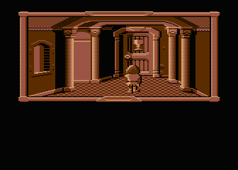

# Klatwa

ASCII Forth reconstruction of **Klatwa (v1)** for Atari XL/XE. The sources
rebuild the saved APX fig-Forth dictionary, assembler, game engine and game
logic. These are recovered low-level sources, not Roland Pantola's original
source screens.



Start with [src/30-game.fth](src/30-game.fth). There are 902 dictionary entries:
824 on the main chain, 76 in the assembler vocabulary and two internal native
entry points. Of these, 519 are colon definitions.
[dictionary.json](dictionary.json) records addresses and naming evidence.

The current name map has 896 entries: 106 intact original names, 229
verified core/source matches, 28 structural candidates and 533 descriptive
inferences. Six entries keep address labels. Original names, APX/GAM matches,
structural sequence candidates, and descriptive inferred names are identified
separately in [tools/names.json](tools/names.json). Structural candidates are
not independently verified original identifiers. Erased names without useful
evidence retain address labels such as `w3817`.

[symbols.txt](symbols.txt) records the inferred names, stack effects and decoded
callers. The semantic pass added 502 names by tracing actual behavior, action
labels, game data and Atari memory accesses. [research-notes.txt](research-notes.txt)
documents the author's tutorial comparisons, runtime probes and unresolved words.
The ten text slots at `$5577` are spellbook entries; inventory uses a separate
mutable object list. Native subroutines and data with saved `DOCOL` fields
carry explicit calling-convention notes.

Manual evidence belongs in [tools/inferred-names.json](tools/inferred-names.json).
`make decompile` merges it into the name map and regenerates the Forth, symbol
catalog and decoded strings. Inferred aliases do not change saved game headers.

## Build

Keep this directory alongside `ad2044`: it reuses that project's validated
APX interpreter harness and listing helpers through [tools/shared.py](tools/shared.py).
Python 3 and `py65` are required.

```sh
cd klatwa
python3 -m venv .venv
.venv/bin/pip install -r requirements.txt
make PYTHON=.venv/bin/python
make test PYTHON=.venv/bin/python
```

Outputs are `build/klatwa.atr`, the playable disk, and `build/sources.atr`,
the source files packed into 64-column, 16-line Forth screens. The report
`build/compile-report.json` contains actual 6502 instruction and disk-write
counts.

The original APX fig-Forth interpreter parses the ASCII files and executes
[src/metacompiler.fth](src/metacompiler.fth). Python supplies Atari OS disk and
console services; it does not translate the target Forth. Every byte of the
first 250 disk sectors is generated by Forth into a blank target region.
The original game disk is needed only for regeneration and comparison, not
for a normal build. [assets/layout.json](assets/layout.json) packs individual
native records from `graphics/records`, fonts from `graphics/fonts`, sprite
frames from `graphics/sprites`, and both `music/*.cmc` modules into a fresh ATR.
Separate files under `assets/` retain state and record padding. The embedded
cursor comes from `graphics/cursors/player-planes.bin`. No disk-tail blob is
used. Changes to these inputs trigger rebuilding through the Makefile.

`make assets` packs only the resource disk; `make sources` packs the Forth
source ATR including embedded assets. Asset sizes and CMC load addresses
remain fixed by the reconstructed layout. See the
[shared asset-build notes](../README.md#building-the-forth-games-from-assets)
for exact inputs and editing constraints.

## Compile from the source ATR

Use the supplied exact `reference/figforth.atr` revision on an Atari XL/XE
with BASIC disabled and at least 48 KB of available RAM. The emulator must
support the 4096-sector source ATR.

1. Boot `reference/figforth.atr` as D1.
2. Mount `build/sources.atr` as D2.
3. Mount a writable copy of `build/assets.atr` as D3.
4. Enter:

   ```forth
   HEX 1000 2463 ! 1000 OFFSET ! 1 LOAD
   ```

5. Wait for `KLATWA BUILD COMPLETE`, then boot the rebuilt D3 disk as D1.

This changes the exact APX host's source-sector divisor, allowing its stock
`LOAD` and `-->` words to read the larger source disk. Target writes go directly
to D3. The initial `Isn't unique` notices are expected emitter redefinitions.
Compilation is substantially faster with emulator turbo mode enabled.

## What the files contain

| File | Contents |
| --- | --- |
| `src/metacompiler.fth` | Target byte/cell emitters and disk writer |
| `src/00-target-words.fth` | Target CFA symbols |
| `src/05-emission.fth` | Faster source-reading emitters |
| `src/06-assembler.fth` | Forth target assembler for all 151 official NMOS 6502 opcodes |
| `src/10-kernel.fth` | Boot loader, release-specific bypass and APX kernel |
| `src/20-framework.fth` | Assembler, graphics, input, sound and engine words |
| `src/30-game.fth` | Game actions, main loop and scrolling introduction |
| `src/40-disk-residue.fth` | Retired dictionary/source remnants outside the boot image |

All `.fth` files are ASCII with LF newlines and lines at most 64 characters.
`DOCOL` emits a colon-definition code field; target symbols emit calls;
`LIT8` and `LIT16` emit literals. Branch offsets retain destination comments.
ATASCII strings retain their exact bytes and have readable comments. Native
6502 bodies and verified machine-code tails use executable assembler
mnemonics. `BYTES` retains headers, tables and unclassified mixed regions.
`INCBIN` imports the native cursor bitmap. Both build paths expand it into
ordinary ASCII `BYTES`; the source ATR is directly compilable in Atari Forth.

The assembler loads after `05-emission.fth`. Its hexadecimal prefix syntax
includes `LDA.# 03`, `STA.ZP D1`, `LDA.ABS 0000`, and `JSR.ABS E456`.
`BNE 2A01` specifies an absolute destination and computes the relative branch;
`RTS` is implied and `ASL.A` selects the accumulator. Explicit addressing modes
preserve absolute instructions even below `$0100`. Byte operands and branch
displacements are range-checked.

The stock APX host has no assembler, so this target assembler is written in
ordinary Forth. It is separate from the original postfix assembler retained
inside the game's GAM dictionary. Conventional `CODE` would allocate fresh headers
and addresses; emitting the saved headers and assembled instructions directly
preserves the original target layout.

[strings.txt](strings.txt) is a readable ASCII catalog of dictionary messages
and menu labels. [strings.json](strings.json) includes addresses, raw bytes,
lengths, inverse characters, and action-label references. `Decoded text:`
comments also appear beside the corresponding `BYTES` records in the Forth.
The game font uses `=` for spaces and lowercase slots for Polish letters;
the catalog transliterates those letters to ASCII. Unsupported glyphs are
shown as `[XX]`. Ordinary ATASCII strings keep their case and punctuation.

The parser follows counted records, resolves action aliases once, and decodes
the obfuscated message using the game's own byte transformation. Incomplete
records and unresolved references are marked explicitly. Unused buffer data
and text in binary disk assets are outside this catalog. `make decompile`
regenerates the catalogs and comments; editing them does not alter the game,
because the original `BYTES` data remains authoritative.

The metacompiler deliberately preserves addresses. Native code, packed data
and game definitions contain absolute pointers, so this is not a relocatable
rewrite using ordinary host `: ... ;` definitions. Changing definition sizes
requires updating those addresses and branch offsets.

The disk boot loads 244 sectors at `$0E80..$887F`. The active dictionary ends
at `$882C`, with latest header `$87DF` and startup CFA `$87E7`. Additional
historical Forth code and save-command residue survives after the boot image.
The reconstruction emits that residue through disk sector 250 as explicit
ASCII hex source; it is not concealed inside the asset template. No extended
boot continuation or duplicated address range is needed.

`make decompile` regenerates the checked-in source files from the reference
image. Normal builds do not regenerate them, preserving source edits.
`make test` checks ASCII constraints, a blank 32000-byte initial target region,
all 1040 reconstructed sectors, metadata and expected Forth disk writes.
The final source ATR was also compiled through the original Atari800 `LOAD`
path: the entire rebuilt ATR, including metadata, matched the reference
exactly. Original/rebuilt menu and joystick-right screenshots matched pixel
for pixel; the first-room comparison differed only in 202 pixels within the
animated player sprite, with identical static scenery. Local evidence is in
`build/runtime-validation/report.json`. This is a smoke test, not a complete
playthrough.

The renamed sources also passed a fresh original fig-Forth `LOAD` build from
a blank target: all 210 source screens compiled, and the entire ATR matched
the release byte for byte. Host `HERE` reached `$89E5`, leaving 5,403 bytes
below the writer's `$9F00` limit. Local evidence is in
`build/runtime-validation/semantic-load-report.json`.
[tools/test_semantics.py](tools/test_semantics.py) executes original game
routines to check the inferred behavior and stack effects.

## Graphics

Browse [graphics/index.html](graphics/index.html) locally or view the
[room overview](graphics/rooms-overview.png). The exports include 203 individual
pictures, 20 player sprite frames, two fonts, 181 interaction maps, 12 title
animation compositions and 30 initial room compositions. Room previews apply
the saved default object states; the animated player, generated frame borders,
text windows and subsequent gameplay changes are omitted.

The disk uses a GAM sector-count directory in physical sector 500. Groups
skip that sector and contain nested little-endian 16-bit length-prefixed
records. Pictures start with `x-byte, y, width-bytes, height`. Their compressed
bytes run **down columns**, using `$8D,control,pattern`: the control byte's
high two bits plus one give the pattern length (one to four bytes), and its
low six bits give the repeat count. The decoder transposes this stream into
row-major bitmap bytes. Each byte contains four two-bit pixels, leftmost first.
The format corresponds to the `SMOVE<` graphics routines in the preserved
[GAM FORTH graphics sources](https://github.com/ptodt/gam-forth/blob/main/img/11_B_Graf.TXT).

| Directory | Contents |
| --- | --- |
| `graphics/groups`, `graphics/records` | Unchanged source containers and record payloads, including their contextual data |
| `graphics/pictures` | Decoded row-major 2bpp images and PNG previews |
| `graphics/sprites` | Four directions with five uncompressed player frames each |
| `graphics/fonts` | Original 1,023-byte fonts and glyph sheets |
| `graphics/masks` | Decoded byte-valued interaction maps; these are not transparency masks |
| `graphics/rooms`, `graphics/title-animation` | Composed bitmap bytes and PNG previews |

Room palettes come from each room's three stored playfield colors, with a
black background. Individual room-dependent layers and sprites use grayscale
previews. Title colors follow the game's display routine. Font sheets show
the stored one-bit glyph patterns; the missing final font byte is blank only
in previews. Original payloads, including unused padding, remain preserved.

The composed title and both fonts match live Atari memory byte for byte.
The first room's interior matches apart from the animated player. Compression
is also checked directly against the original 6502 routine. Physical source
spans, image IDs, placement, dimensions, palettes and room layers are listed in
[graphics/extraction.json](graphics/extraction.json).

Run `make graphics` to regenerate, or
`python3 ../util/extract_graphics.py --game klatwa --check` to verify the files.
Native records, fonts and sprite frames selected by `assets/layout.json`
feed the build. Regeneration restores original files and can overwrite
edits; normal `make` does not run it. Decoded pictures and PNGs are previews.

## Music

[music/title.cmc](music/title.cmc) contains four subsongs; the first is the
main title music and the others are short cues. [music/gameplay.cmc](music/gameplay.cmc)
contains two subsongs and the instruments also used by gameplay sound effects.
Both files preserve the original six-byte Atari segment headers and all their
music data unchanged. They are native Chaos Music Composer modules.

| File | Size | ATR offset | Loaded music data | Subsongs |
| --- | ---: | --- | --- | ---: |
| `gameplay.cmc` | 1,675 bytes | `$D98A` | `$86B8..$8D3C` | 2 |
| `title.cmc` | 1,784 bytes | `$E01C` | `$8D52..$9443` | 4 |

Offsets include the ATR header. The enclosing GAM records contain five and
six extra bytes respectively, which are excluded from the CMC files. The
complete extracted payloads match the corresponding music in running-game
RAM. ASAP 8.0.0 independently identifies all six subsongs and renders them
through a full loop; all referenced patterns terminate inside the files.

Run `make music` to regenerate the exports with Python 3. Both CMC files are
build inputs, so regeneration can overwrite music edits.
[music/extraction.json](music/extraction.json)
records source offsets, load addresses, checksums and playback entry points.
Use an [ASAP-compatible player](https://asap.sourceforge.net/) to choose
subsongs, or render one with `asapconv -s 0 -o title.wav music/title.cmc`.
Subsong indices start at zero.

## Provenance

* [Klatwa catalog on AtariOnline](https://atarionline.pl/v01/index.php?ct=kazip&sub=K&title=+Klatwa)
* [Klatwa (v1) reference ATR](https://atarionline.pl/v01/kazip.php?ct=kazip&sub=K&title=+Klatwa&file=Klatwa+%28v1%29.atr)
* [Original AD2044 Forth investigation](https://atarionline.pl/forum/comments.php?DiscussionID=7059&page=1)
* [Preserved GAM FORTH sources](https://github.com/ptodt/gam-forth)

The supplied v1 image includes a release-specific "Unprotect by: GUMI" label
and OS disk-call bypass; these bytes are preserved. Game, runtime and resource
rights remain with their original authors. This reconstruction does not
relicense them.
