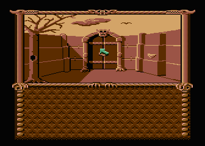

# Wladcy Ciemnosci

ASCII Forth reconstruction of the AtariOnline v1 Atari XL/XE disk release.
The sources rebuild the original saved APX fig-Forth dictionary and the
working game. They are reconstructed, address-preserving sources, not
Roland Pantola's original source screens.



Start with [src/30-game.fth](src/30-game.fth). Named entry points include
`BOOT-TITLE-AND-GAME`, `RUN-TITLE-PAGES`, and `GAME-MAIN-LOOP`. These descriptive
names are explicitly marked as inferred; erased original names cannot be
recovered with certainty.

The dictionary contains 906 entries: 828 in the main chain, 76 in the private
assembler vocabulary, and two native entry points without headers. There are
539 colon definitions and 6,569 decoded threaded instructions. Of the entries,
106 have intact names, 221 match APX kernel headers, 34 have candidate names
from structural comparisons, 32 have inferred descriptive names, and 513
retain their code-field address as an identifier. Per-entry evidence is in
[dictionary.json](dictionary.json) and [tools/names.json](tools/names.json).
Structural candidates are not independently verified semantic identifications.

## Source layout

| File | Contents |
| --- | --- |
| [src/metacompiler.fth](src/metacompiler.fth) | Portable APX compiler and streaming disk writer |
| [src/00-target-words.fth](src/00-target-words.fth) | Target code-field symbols |
| [src/05-emission.fth](src/05-emission.fth) | Fast literal, cell, and byte emitters |
| [src/10-kernel.fth](src/10-kernel.fth) | Boot code and modified fig-Forth kernel |
| [src/20-framework.fth](src/20-framework.fth) | Assembler, graphics, text, input, audio and disk support |
| [src/30-game.fth](src/30-game.fth) | Game definitions and startup |
| [src/40-disk-residue.fth](src/40-disk-residue.fth) | Retired dictionary and save-command bytes outside the boot image |

Every `.fth` file is ASCII, with LF newlines and lines at most 64 characters
wide. `DOCOL` emits a target colon definition, a `t.` name emits a target call,
`LIT8`/`LIT16` emit literals, and `AT` checks the target address. Branch cells
retain signed offsets and have destination comments. `BYTES` emits headers,
native 6502 instructions, and data; native instructions have disassembly
comments. Embedded tables can make linear disassembly comments misleading.
The 602 undecoded trailing bytes reported by the generator are tails of colon
definitions, not a count of all native code or data.

This is low-level threaded Forth, not a relocatable rewrite. Absolute pointers
in code and data require preserving the memory layout. Changing definition
sizes requires corresponding address and branch updates. Game resources in
[assets/disk-tail.bin](assets/disk-tail.bin) remain binary.

## Build

Python 3 and `py65` are required:

```sh
cd wladcy-ciemnosci
python3 -m venv .venv
.venv/bin/pip install -r requirements.txt
make PYTHON=.venv/bin/python
make test PYTHON=.venv/bin/python
```

The outputs are `build/wladcy-ciemnosci.atr`, `build/sources.atr`, and the
initially blank target `build/assets.atr`. Compilation runs the genuine APX
fig-Forth 6502 interpreter from `reference/figforth.atr`; Python provides only
Atari OS input/output services. It does not translate Forth or insert a saved
copy of the program. Host compilation takes several minutes.

The target starts with all 32,000 program and residual-code bytes zero.
Forth writes every byte of the first 250 sectors. Only the independent resource
tail is retained. Normal builds do not read the reference game ATR or run the
decompiler. Verification compares the entire resulting ATR, including its
header and all 1,040 sectors, with the original release.

## Compile the source ATR with Atari fig-Forth

Use an Atari XL/XE emulator with BASIC disabled, at least 48 KB of available
RAM, and support for large 128-byte-sector source ATRs.

1. Boot `reference/figforth.atr` as D1.
2. Mount `build/sources.atr` as D2.
3. Mount a writable copy of `build/assets.atr` as D3.
4. Enter this command at the Forth prompt:

   ```forth
   HEX 1000 2463 ! 1000 OFFSET ! 1 LOAD
   ```

5. Wait for `WLADCY BUILD COMPLETE`. D3 contains the rebuilt game and can be
   booted as D1.

The command changes this exact APX version's host `R/W` sector divisor from
720 to 4096 and selects D2 source blocks. It does not modify game code.
The source disk contains 166 screens and uses the stock `-->` continuation.
Each physical screen line reserves a trailing space; Forth does not insert
newlines between its 64-character rows. Expected `Isn't unique` notices come
from the deliberate emitter redefinitions in `05-emission.fth`. Turbo mode
speeds compilation substantially.

## Recovery and validation

`make decompile` regenerates sources and the resource split from the reference
image. Regeneration and the parser tests reuse the AD 2044 listing helpers and
naming evidence through [tools/shared.py](tools/shared.py), so keep the sibling
[ad2044](../ad2044) directory when doing that work. Building the checked-in
Forth sources is independent of those regeneration helpers.

The v1 boot loads 242 sectors at `$0E80..$877F`. The saved dictionary ends at
`$8758`, with last main header `$8715`. Retired `N>N` and `SAVE-RUN` definitions
remain in the padding; additional stale dictionary data, including residue
shared with Klatwa, remains after the boot image. All of this is reconstructed
through `$8B7F`, rather than retained as a hidden program copy in the assets.
The custom counted-string runtime is `$3A8B`; `CLIT`, `COMPILE` operands,
unaligned cells, and private vocabulary chains are handled explicitly.

The final source ATR was compiled through the real Atari800 `LOAD` path into
a target whose 32,000 program bytes were initially zero. The result matched
the complete original ATR byte for byte. The rebuilt main menu, first room,
and joystick movement screenshots matched the original. This is a smoke test,
not a full playthrough. Use [tools/emulate-smoke.json](tools/emulate-smoke.json)
with the sibling [Atari800 harness](../ad2044/tools/emulate.py) for an optional
repeat; it requires Atari800, Xvfb, and Python Xlib.

## References

* [AtariOnline game catalog](https://atarionline.pl/v01/index.php?ct=kazip&sub=W&title=+Wladcy+Ciemnosci)
* [Selected v1 disk](https://atarionline.pl/v01/kazip.php?ct=kazip&sub=W&title=+Wladcy+Ciemnosci&file=Wladcy+Ciemnosci+%28v1%29.atr)
* [Forth reverse-engineering discussion](https://atarionline.pl/forum/comments.php?DiscussionID=7059&page=1)
* [APX Extended fig-Forth documentation](https://atariwiki.org/wiki/Wiki.jsp?page=Extended+Atari+FIG-Forth+APX20029)
* [Preserved GAM FORTH sources](https://github.com/ptodt/gam-forth)

The game and its original resources remain the work of their original authors;
this reconstruction does not change their licensing.
